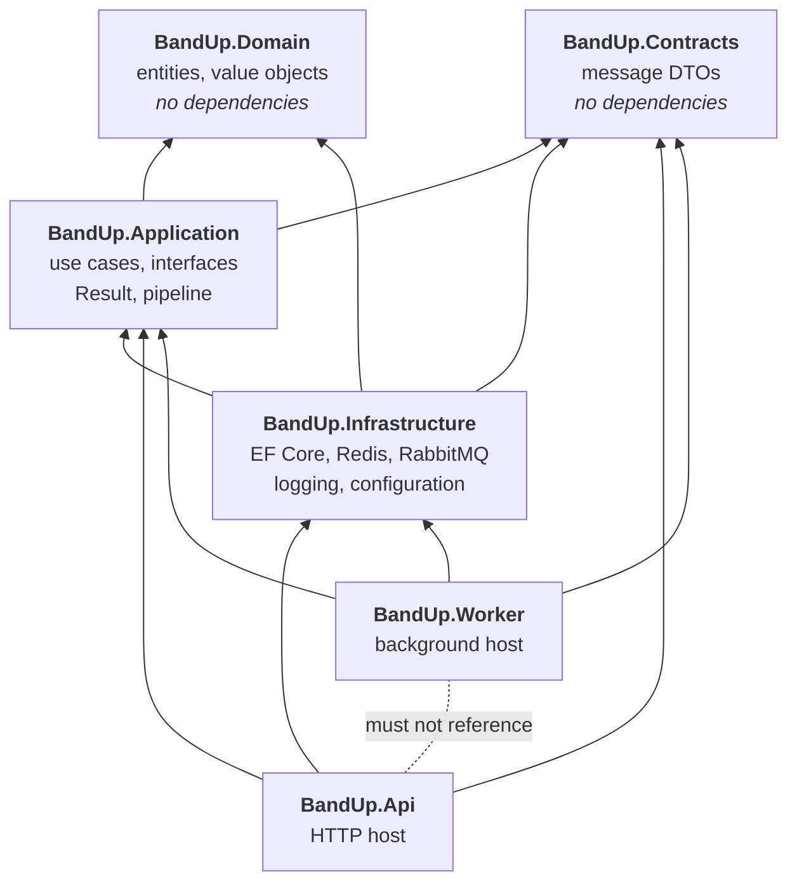
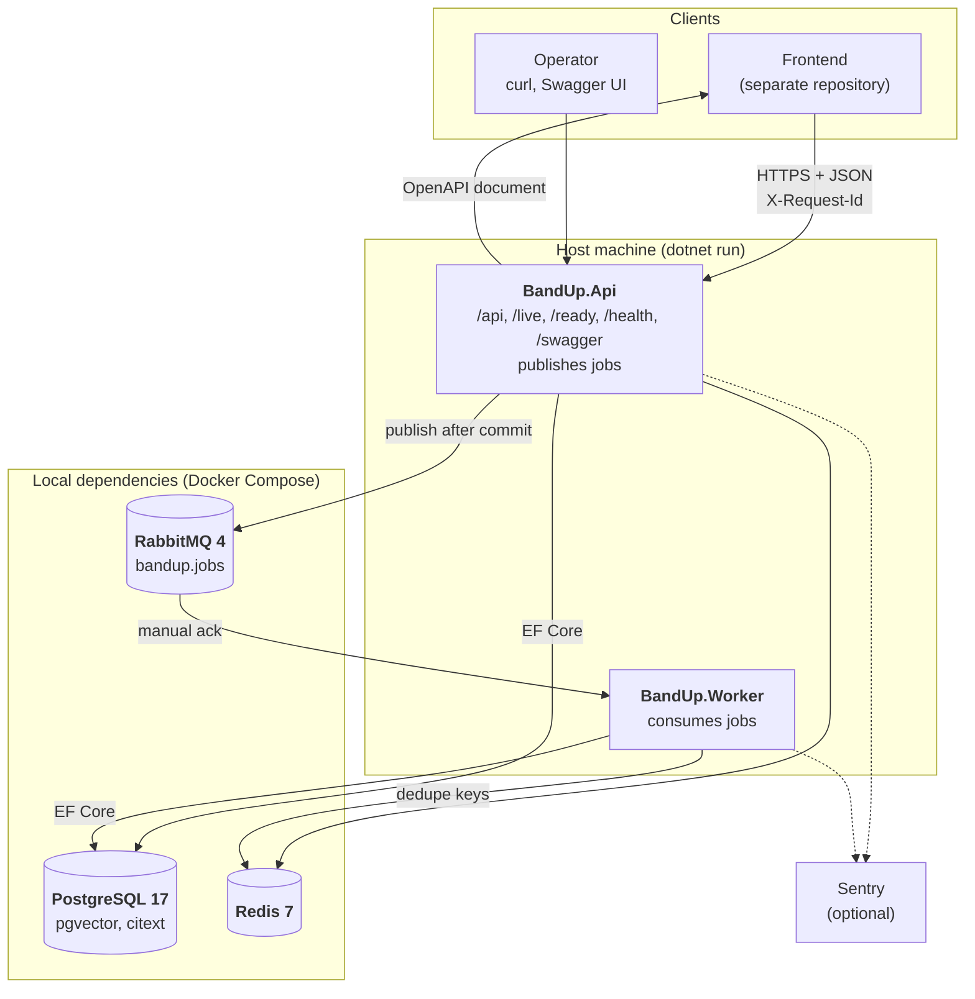
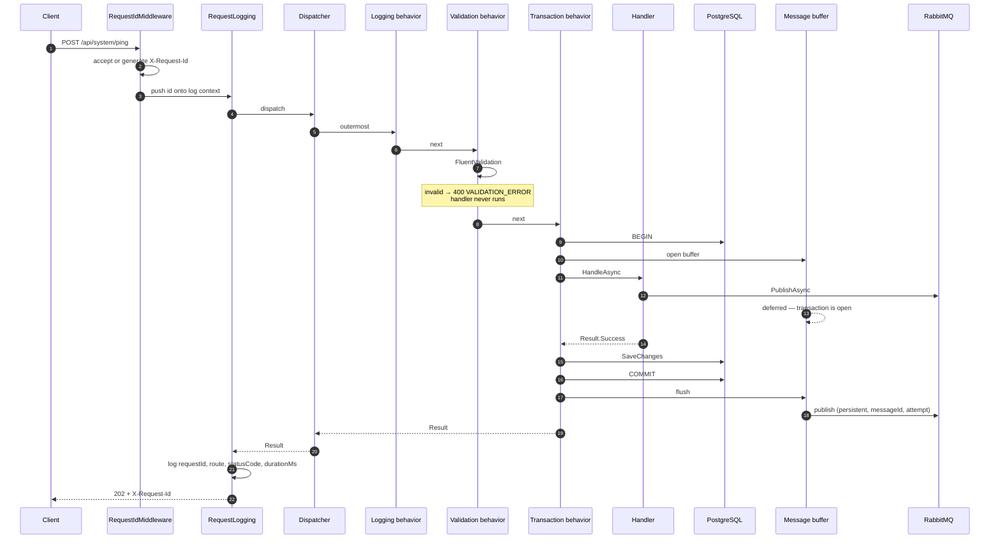

# BandUp backend architecture

A complete description of the backend as built. Self-contained: it can be handed to a
rendering tool without any other document.

> **Rendering notes.** This file is structured for conversion to a single HTML page.
> `##` headings are top-level sections and should become the navigation. Each
> `mermaid` fenced block is a diagram to render as SVG. Tables should be styled as tables.
> Code blocks are illustrative and can stay monospaced. Nothing here depends on images
> stored elsewhere in the repository.

---

## 1. What the system is

BandUp is an IELTS Reading and Writing preparation platform. This repository contains its
backend foundation, the System reference feature, cookie-based Identity sessions, and signup
credit accounts in Billing. Registration, login, profile, refresh and logout are implemented.

It is a **modular monolith**: a single deployable API, a single Worker process, and one
database. Modules are separated by convention and enforced by tests, not by network
boundaries.

| Property | Value |
|---|---|
| Runtime | .NET 10 (LTS), ASP.NET Core minimal APIs |
| Database | PostgreSQL 17 with `pgvector` and `citext` |
| Cache | Redis 7 |
| Messaging | RabbitMQ 4, `RabbitMQ.Client` v7 (async) |
| Logging | Serilog, one JSON object per line to stdout |
| Errors | Sentry (optional, disabled by an empty DSN) |
| Tests | xUnit v3 on Microsoft Testing Platform, Testcontainers |

---

## 2. The six projects

The solution is split into six projects with a strict, one-directional dependency graph.



The rule is **inward only**: dependencies point toward the centre. Domain and Contracts sit at
the centre and depend on nothing. The hosts sit at the edge and depend on everything.

| Project | Owns | Must never contain |
|---|---|---|
| **Domain** | Entities, value objects, domain services, invariants | EF, HTTP, DI, framework attributes |
| **Contracts** | Message shapes shared across processes | Anything with a dependency |
| **Application** | Use cases, interfaces, DTOs, validators, pipeline | EF, ASP.NET, Redis, RabbitMQ types |
| **Infrastructure** | Database, cache, broker, logging, configuration | Business rules |
| **Api** | HTTP mapping, middleware, health, OpenAPI | Business logic |
| **Worker** | Consumers that call Application handlers | Business logic |

### Why this shape

Business rules live where nothing can drag a framework into them, so they are testable without
a database, a broker or a server. Swapping a technology touches Infrastructure only. And the
API and Worker cannot reference each other, so neither can accidentally become the other.

**This is not a convention; it is enforced.** Architecture tests read the compiled assemblies
and the project files and fail the test run on a wrong-direction reference, including a
`ProjectReference` that is merely unused.

---

## 3. Runtime view



Three things are worth stating explicitly:

- **Only the API serves HTTP.** The Worker has no listening socket; its health is whether it
  is consuming, and it reports through logs and Sentry.
- **Both hosts declare the RabbitMQ topology at startup.** Declaring is idempotent, so the
  overlap is harmless, and it guarantees the exchange exists before either process publishes
  or consumes.
- **Redis also holds access-JWT revocation entries.** Cache reads used for authentication
  fail open on Redis outage, so logout enforcement has an explicit availability limit.
  Logout writes fail the command on outage. PostgreSQL and Redis have no shared transaction.

---

## 4. A request, end to end

This is the single most important diagram in the system. Every feature follows it.



**The order of the three behaviors is load-bearing:**

1. **Logging outermost** so it sees the final outcome, including failures.
2. **Validation before the transaction** so an invalid command never opens one.
3. **Transaction innermost** so it wraps only the handler's work.

The transaction is a **command-only** behavior. The dispatcher filters it out of the query
pipeline, so a read can never open a transaction.

On a failed `Result` or an exception, the buffer is **discarded** and the transaction rolled
back — the message is never published, so a consumer cannot observe a row that was undone.

### Identity session flow

The HTTP pipeline runs request-id/logging/CORS and the CSRF guard before authentication and
authorization. JWT authentication reads the access cookie, validates it, checks required
session claims, then checks its JWT id against the revocation store. Authentication challenges
use the same ProblemDetails/request-id format as handler errors.

| Use case | Application action | HTTP action after dispatch |
|---|---|---|
| Login | Validate CAPTCHA/password and issue access/refresh credentials | Write cookies and return user JSON |
| Refresh | Lock the user's sessions, re-read, rotate a usable refresh row | Replace cookies; empty `200` |
| Reuse | Revoke all unrevoked refresh rows and return a completed security outcome | Clear cookies; `401 INVALID_REFRESH_TOKEN` |
| Logout | Revoke the presented owned refresh row and blacklist the validated access JWT | Clear cookies; empty `204` |

Reuse is deliberately carried by a successful command outcome so the transaction commits
the security action before the endpoint rejects renewal. Ordinary invalid refresh results
still roll back. Raw credentials stay internal to issuance and cookie transport. The current
role and configured lifetimes come from the shared issuer and locked user snapshot.

All refresh/logout database changes lock the same user row at Read Committed isolation;
different users can proceed independently. Clients must coordinate refresh and logout because
database locks cannot order cookie updates in concurrent HTTP responses. See
[the browser contract](../auth-client-contract.md) and
[ADR 0016](../adr/0016-refresh-logout-contracts-and-commit-outcomes.md) for exact race and
partial-failure behavior.

---

## 5. The layers in detail

### 5.1 Domain

Pure logic. Entities carry identity; value objects carry equality by their parts. The domain
never reads the clock — anything that needs time receives it as an argument — and it throws
`DomainException` only to signal a violated invariant, which is a programming error, never an
expected failure.

### 5.2 Contracts

Message shapes that cross a process boundary. It depends on nothing, which is what lets both
the API and the Worker reference it without either dragging the other's dependencies in.
Business messages carry **ids only, never user content**; the one exception is the diagnostic
ping.

### 5.3 Application

Use cases and the interfaces they need. Three ideas define it:

**CQRS-lite.** Commands and queries are plain `record`s. A hand-written dispatcher resolves the
single handler for a request and runs it through the behavior chain. There is no mediator
library.

**Result, not exceptions.** Expected failures — validation, not found, conflict, forbidden —
are *returned*. Exceptions mean a bug or an infrastructure fault and surface as `500`. This is
what lets the transaction behavior inspect an outcome without catching anything.

**Interfaces at the boundary.** Everything external — the database, the cache, the broker, the
clock, the host environment — is an interface declared here and implemented in Infrastructure.
Application can therefore be tested with no infrastructure at all.

### 5.4 Infrastructure

The only project that knows about a technology. It holds:

| Area | Responsibility |
|---|---|
| Persistence | `DbContext`, naming conventions, unit of work, generic repository, migrations |
| Caching | Redis and in-memory implementations of one interface |
| Messaging | Connection, topology, publisher, consumer base, buffering |
| Logging | The JSON formatter, the masking policy, the logger factory |
| Configuration | One settings class per section, validated at startup |
| Composition | A single `AddInfrastructure` entry point |

Both hosts call the same `AddInfrastructure`, so the two processes cannot drift apart.

### 5.5 Api

Thin. It maps HTTP to a request, dispatches, and maps the `Result` to a status. It also owns
the things that only make sense for an HTTP process: request ids, CORS, forwarded headers,
OpenAPI, health endpoints and the exception handler.

Endpoints are grouped per module by a small abstraction and discovered by assembly scan, so
adding a module never means editing the composition root.

### 5.6 Worker

Consumers. A consumer declares its queue and implements a handle method; acknowledgement,
retry with backoff, duplicate suppression and graceful shutdown are inherited from a base
class. A consumer contains no infrastructure code.

---

## 6. Cross-cutting contracts

### Errors

Every expected failure becomes RFC 7807 with two additions: a stable `code` and a `traceId`.
The `traceId` **is** the request id, so a six-character reference shown to a user can be found
in the logs.

| Error type | HTTP | Meaning |
|---|---|---|
| Validation | 400 | input rejected, `errors` map present |
| Unauthorized | 401 | no valid identity |
| Payment required | 402 | reserved for credits |
| Forbidden | 403 | identity known, action not allowed |
| Not found | 404 | absent — also used for "not yours", to avoid leaking existence |
| Conflict | 409 | state collision |
| Unprocessable | 422 | reserved |
| Too many requests | 429 | reserved |
| Unavailable | 502 | a dependency failed |
| Unexpected | 500 | a bug; the detail is generic and the exception goes to the log |

One place maps a type to a status, and one place builds the body. Stack traces and internal
messages never reach a response.

### Logging

One JSON object per line on stdout, with a fixed key set: `timestamp`, `level`, `message`,
`requestId`, `userId`, `route`, `statusCode`, `durationMs`, `service`, plus `exception` when
present.

Any property whose name contains `password`, `token`, `authorization`, `cookie`, `secret` or
`essayText` is replaced with `***`; `email` is partially masked (`s***@example.com`). The
policy is applied in the formatter, so no sink can bypass it. Health probes are not logged.

### Configuration

Every setting comes from the environment. Each section has a typed class, validated, and
**validated at startup** — a missing required value stops the process with a message naming
the key, rather than surfacing later as a null reference.

External dependencies select their implementation by configuration:

```
Cache__Provider=Redis|InMemory
MessagePublisher__Provider=RabbitMq|InMemory
```

That is how the tests run offline and how a developer can run without a broker.

### Health

| Endpoint | Answers | Used by |
|---|---|---|
| `/live` | is the process running | orchestrator, to decide on restart |
| `/ready` | are dependencies reachable **and** is the schema current | load balancer, to decide on traffic |
| `/health` | detailed per-dependency status | humans and dashboards |

`/ready` includes a pending-migrations check, because migrations are applied by an explicit
command and a process must not serve traffic against a stale schema.

---

## 7. Data and messaging

### Database

One database, one schema per module. `snake_case` identifiers throughout, applied by a naming
pass over the model. GUID primary keys generated in the application as version 7 (time-ordered,
so index locality is preserved and an id is known before the insert). `timestamptz` in UTC.
Enums stored as text with a `CHECK` constraint. An `xmin` mapping helper is available;
Identity session concurrency uses explicit per-user row locks. The current module schemas
are `identity` (users, refresh tokens) and `billing` (credit accounts, ledger). No soft delete
or lazy loading.

Migrations are **never** applied on startup. An explicit command applies them and exits with a
status code, so several instances cannot race and a rollback of the application does not roll
back the schema.

### Messaging

One direct, durable exchange. Queues are durable and the queue name is the routing key.
Messages are persistent JSON with a `messageId` and an `attempt` header.

**Publish only after commit** is enforced by the foundation, not by discipline: a decorator
holds messages while a transaction is open and releases them once it commits.

**Consumers are idempotent by inheritance.** A handled `messageId` is recorded in the cache
after a successful handle and before the acknowledgement, so a redelivery is acknowledged
without running the handler twice. The record is written *after* success, not before handling:
a pre-claim would lose a message if the process died mid-handler.

There is no dead-letter queue in this stage. A message that fails three times in-process is
handed to a final-failure hook and acknowledged.

---

## 8. Testing strategy

| Level | What it proves | Infrastructure |
|---|---|---|
| **Unit** | pipeline order, transaction semantics, validation, logging policy | none |
| **Architecture** | the dependency graph and framework bans | none |
| **Integration** | the real hosts against real containers | Testcontainers, started once per run |

Integration tests start their own PostgreSQL, Redis and RabbitMQ, so they neither use nor
disturb a developer's local stack, and the suite runs from a clean clone.

Test names begin with the scenario identifier they cover, which is how a requirement traces to
a test.

---

## 9. Decisions

Each of these has a full record in `docs/adr/`.

| # | Decision |
|---|---|
| 0001 | Modular monolith with Clean Architecture; enforced by tests |
| 0002 | CQRS-lite with a hand-written dispatcher; no mediator library |
| 0003 | Result pattern for expected failures |
| 0004 | PostgreSQL with pgvector, one schema per module |
| 0005 | RabbitMQ producer/consumer, publish after commit |
| 0006 | .NET 10 LTS with exact package pinning |
| 0007 | Migrations applied by an explicit command |
| 0008 | Application references Contracts, so handlers can publish their messages |
| 0009 | Transaction-aware publishing via a buffer flushed after commit |
| 0010 | Consumer idempotency through a cache-backed handled set |
| 0011 | Topology declared at startup by both processes |
| 0012 | Cookie-carried access JWTs, opaque rotating refresh tokens and CAPTCHA adapters |
| 0015 | Module schemas and sequential migrations |
| 0016 | Refresh/logout HTTP contracts, locking and committed revocation outcomes |

---

## 10. Deliberately absent

Not oversights. Each was considered and rejected for this stage; adding one means writing an
ADR first.

| Absent | Consequence |
|---|---|
| Mediator, mapping, scanning libraries | ~150 more lines of our own code, but no runtime failure mode and no licence |
| Transactional outbox | A crash between commit and flush loses a message |
| Dead-letter queue | A permanently failing message is lost after three attempts, recorded by the final-failure hook |
| Soft delete | Deletes are real and irreversible |
| Lazy loading | Every query states what it loads |
| Rate limiting, audit tables, analytics | Later steps, each with its own decision |

---

## 11. How a feature is added

The reference feature — server time and ping — is the template. Adding a feature means:

1. A message in Contracts, if the feature publishes one.
2. A command or query record, its handler, and its validator in Application.
3. An entity and a configuration if it stores data, plus a migration.
4. An endpoint group in Api.
5. A consumer in Worker, if it reacts to a message.
6. A scenario test, named after its identifier.

Nothing in the foundation changes. That is the point of building it first.

The step-by-step recipe, with the actual files, is `docs/how-to-add-a-feature.md`.
