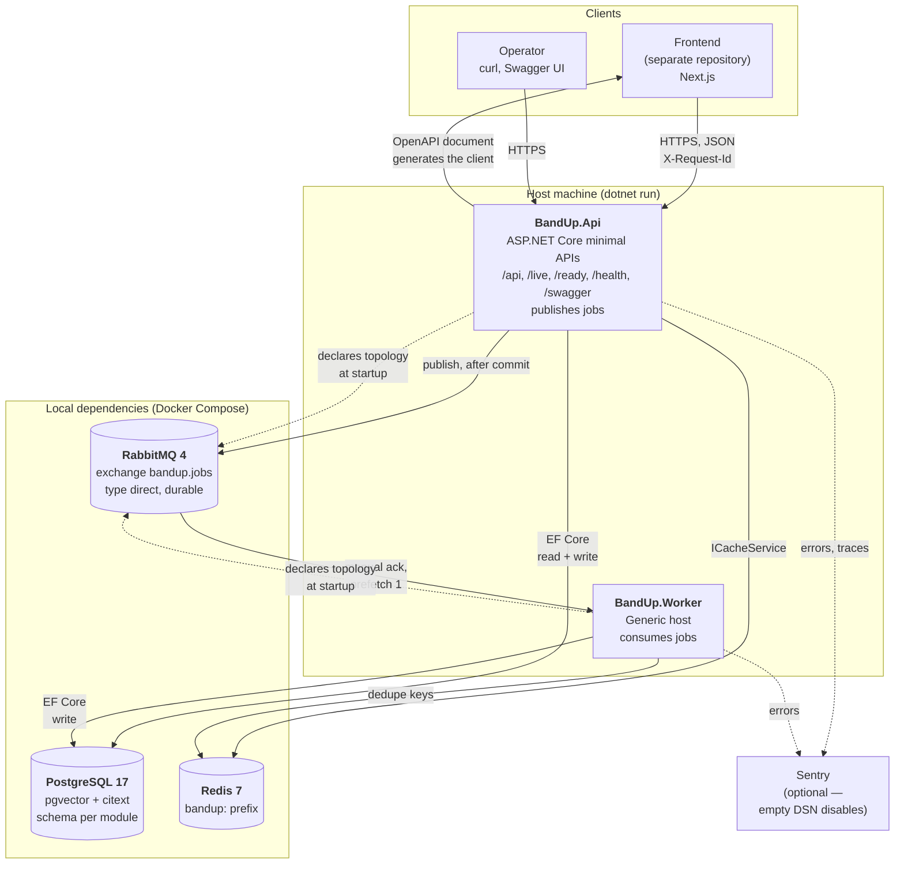
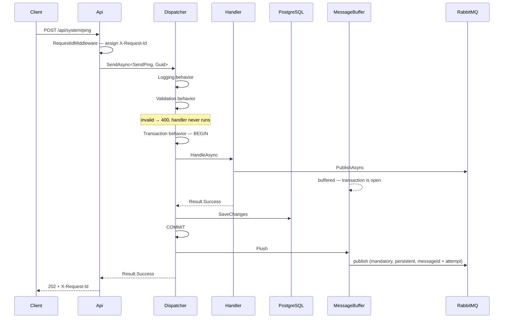

# Container view

What runs, and what it talks to. The API and the Worker are host processes, not containers:
they run with `dotnet run` and are only containerised in a later deployment step.

## Notes

**Both hosts declare the RabbitMQ topology at startup.** Declaring is idempotent, so the
overlap is harmless, and it guarantees the exchange exists before either process publishes or
consumes. See [ADR 0011](../adr/0011-topology-declared-by-both-processes.md).

**Only the API serves HTTP.** The Worker has no listening socket; its health is whether it is
consuming. It reports to Sentry and to stdout logs.

**The frontend is a separate repository.** It consumes this API through the generated OpenAPI
document; there is no shared code between them.

**One database, one schema per module.** Modules do not read each other's tables. See
[ADR 0004](../adr/0004-postgresql-pgvector-schema-per-module.md).

**Redis is a cache, not a source of truth.** Losing it costs a cold cache and a wider duplicate
window for consumers, not data. See [ADR 0010](../adr/0010-consumer-idempotency.md).

**Sentry is optional.** An empty `Sentry__Dsn` disables it, which is the local default.

## Request flow

A command, end to end:

A rollback discards the buffer instead of flushing it, so the consumer never sees the message.
See [ADR 0009](../adr/0009-transaction-aware-message-publishing.md).